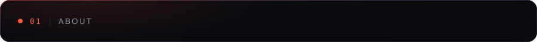
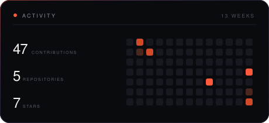
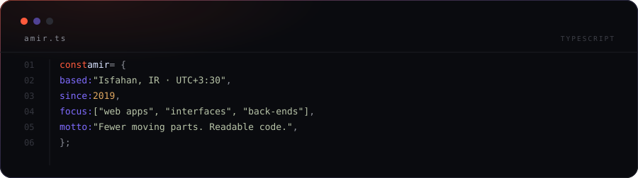
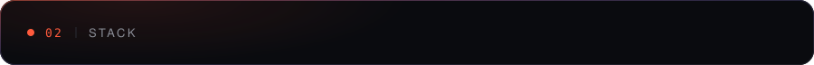
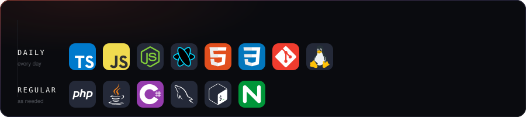
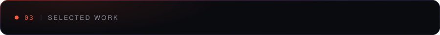
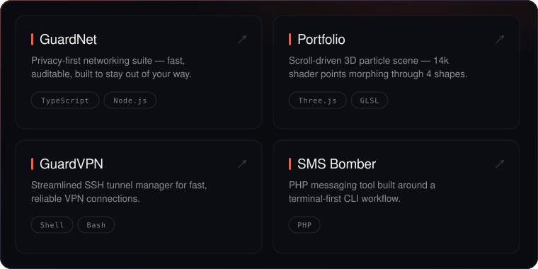
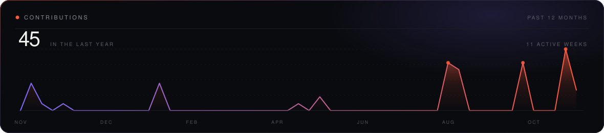

 

 

<table>
<tr>
<td width="50%" valign="middle">

I build web applications end to end. Clean interfaces on the front,
solid services behind them, and just enough infrastructure to keep it
running without babysitting.

</td>
<td width="50%" valign="middle">

</td>
</tr>
</table>

 

 

 

 

 

